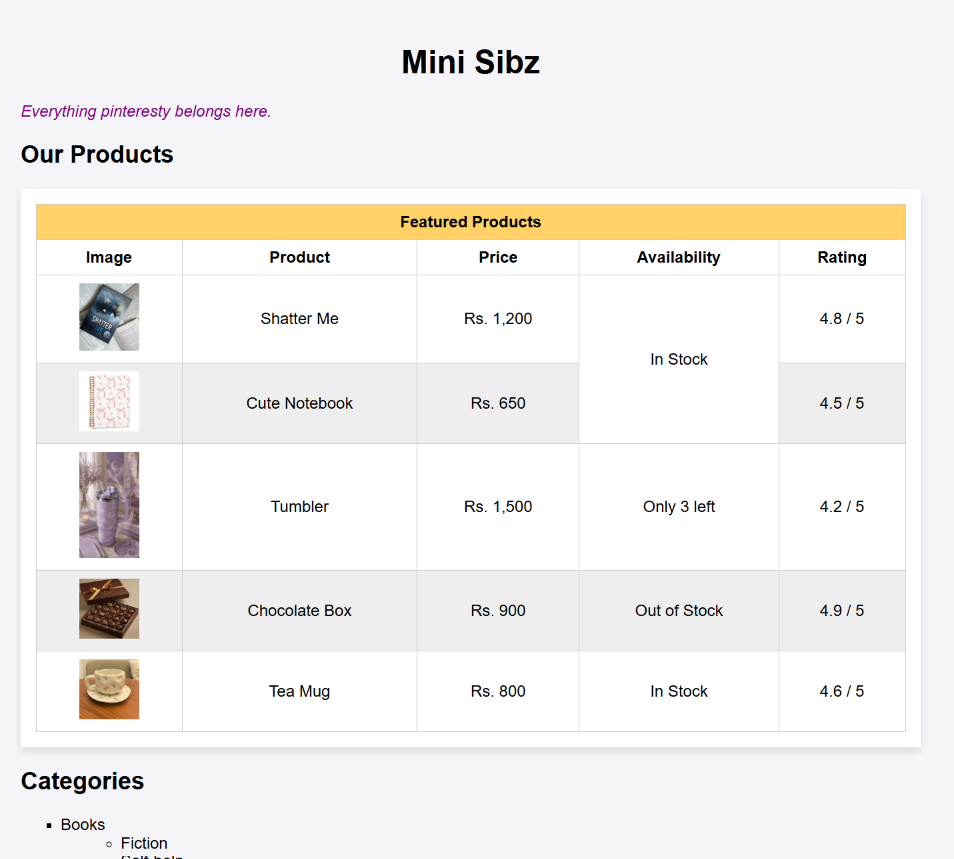
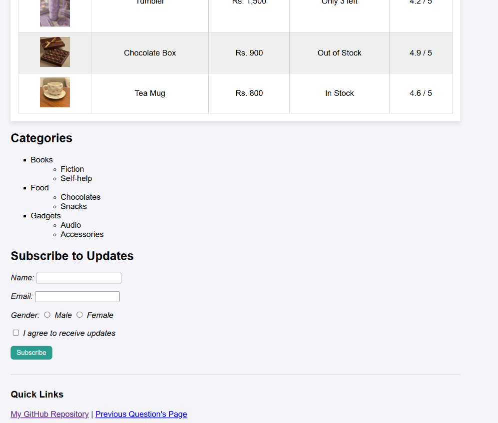

# Mini Sibz - My Mini Store

A one-page online store for everything pinteresty: a book, a notebook, a tumbler, chocolate and a mug.
It has a styled product table, a nested category list and a subscribe form.

## CSS Precedence

- **Tagline paragraph colour:** Dark green (#006400). The inline style wins.
- **Other `
` tags:** Dark red (#8b0000) and italic. The internal CSS overrides the external gray (#555).
- **Why:**
  1. Inline styles have the highest specificity, so the tagline's green beats everything.
  2. The internal and external rules both use `p`, so they are equally specific, and the internal one wins because it comes later.
  3. The order is inline > internal > external.

## Screenshots

