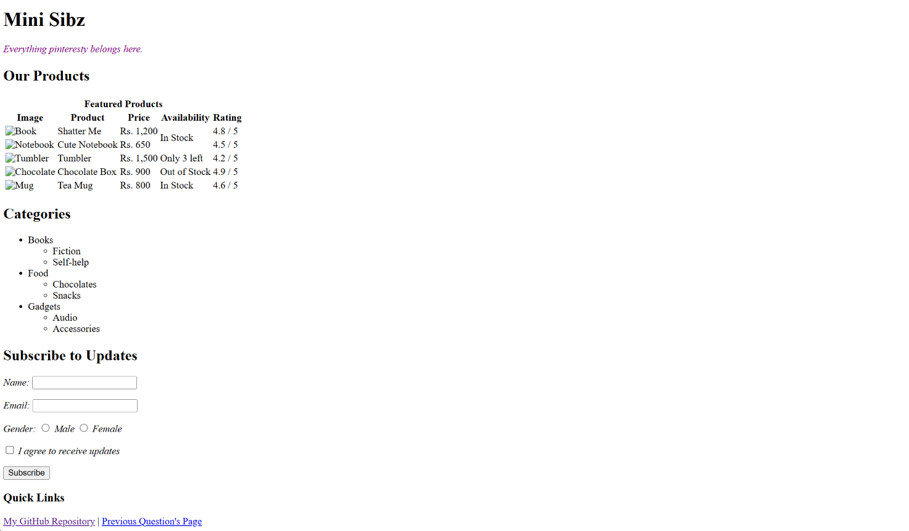

# Mini Sibz - My Mini Store

A one-page online store for everything pinteresty: a book, a notebook, a tumbler, chocolate and a mug.
It has a styled product table, a nested category list and a subscribe form.

## CSS Precedence

- **Tagline paragraph colour:** Purple. The inline style wins.
- **Other `
` tags:** Black and italic. The internal CSS overrides the external gray (#555).
- **Why:** Inline styles are the strongest, so purple beats everything.
  The internal and external rules both use `p`, so they are equally specific, and the later one (internal) wins.
  The order is inline > internal > external.

## Screenshot

